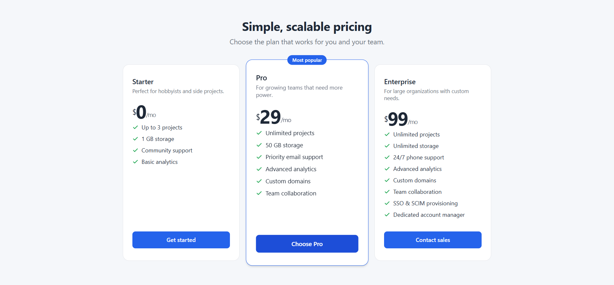

# Pricing Cards 💳



## About the project

This project is a responsive pricing cards page built with HTML and CSS. It displays three pricing plans — Starter, Pro, and Enterprise — each with its own set of features, price, and call-to-action button. The Pro plan is highlighted as the most popular option.

### How it works

The page uses a CSS grid layout that adapts to different screen sizes. On desktop, the three cards sit side by side. On mobile devices smaller than 640px, they stack vertically. Each card includes a plan name, tagline, price, feature list with checkmark icons, and a button.

### What I did

I implemented the pricing cards challenge from [roadmap.sh](https://roadmap.sh/projects/pricing-cards) using pure HTML and CSS:

- Structured the page with semantic HTML (`<article>`, `<header>`, `<ul>`)
- Designed three pricing cards with clean typography and color variables
- Added hover effects and a scale transform for the featured card
- Made the layout responsive with a media query for mobile
- Used CSS custom properties for easy theming and maintenance

## Project definition

The original project definition can be found here: https://roadmap.sh/projects/pricing-cards

## How to run this project locally

1. Clone the repository:

```bash
git clone https://github.com/DevMasen/pricing-cards.git
cd pricing-cards
```

2. Open `index.html` in your browser:

```bash
# On Windows
start index.html

# On macOS
open index.html

# On Linux
xdg-open index.html
```

Or simply double-click the `index.html` file in your file explorer. No build step or server is required.

## My solution

If you like this project please vote using this [LINK](https://roadmap.sh/projects/pricing-cards/solutions?u=66107474da1671f986289b45)

## Thank you

Thank you for visiting my GitHub and checking out this project! 🙏
